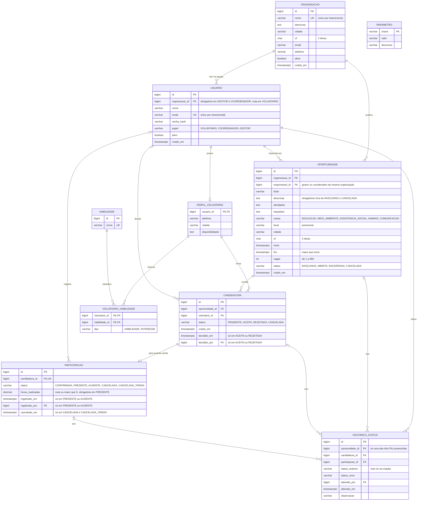

# DER

Modelo do Voluntare (v2). Diagrama em Mermaid (o GitHub renderiza direto). O código-fonte do diagrama está em `der.mmd` e a imagem em `der.png`. O schema que implementa este modelo está em `backend/src/main/resources/db/migration`.

## Atores

| Papel | Quem é | O que faz |
|---|---|---|
| `GESTOR` | Administrador da ONG (root da organização) | Cadastra a ONG (autocadastro), cadastra coordenadores, cria vagas e define o responsável por cada uma. Pode operar qualquer vaga da sua ONG |
| `COORDENADOR` | Coordenador da ONG | Só mexe nas vagas pelas quais responde: candidaturas, aceite, presença e horas |
| `VOLUNTARIO` | Voluntário | Cadastra-se sozinho, mantém o perfil, candidata-se e cancela |

Não existe administrador da plataforma. A ONG se autocadastra: a organização e o seu gestor nascem na mesma transação.

Cardinalidades principais:

- Uma organização tem vários gestores e coordenadores (1 para N). O voluntário não pertence a organização.
- Uma organização publica várias oportunidades (1 para N).
- Um gestor ou coordenador responde por várias oportunidades (1 para N). Cada oportunidade tem um único responsável.
- Um usuário voluntário tem um perfil (1 para 0..1).
- Uma oportunidade recebe várias candidaturas e um voluntário envia várias candidaturas (1 para N).
- Uma candidatura aceita gera uma participação (1 para 0..1).
- Voluntário e habilidade são N para N, pela tabela de junção.
- Um usuário decide candidaturas, registra participações e altera status (1 para N em cada caso). Quem faz a ação fica em `decidido_por`, `registrado_por` e `alterado_por`.
- Cada linha de `historico_status` pertence a uma única oportunidade, candidatura ou participação.

## Dicionário resumido

| Entidade | Descrição |
|---|---|
| `organizacao` | ONG que publica oportunidades. Tem equipe (gestores e coordenadores) |
| `usuario` | Conta de acesso. O campo `papel` define o que a pessoa pode fazer e `organizacao_id` a ONG de quem é da equipe |
| `perfil_voluntario` | Dados extras do voluntário. Usa o mesmo id do usuário |
| `habilidade` | Catálogo de habilidades e interesses do voluntário |
| `voluntario_habilidade` | Liga voluntário e habilidade. O campo `tipo` diz se é habilidade ou interesse daquela pessoa |
| `oportunidade` | Ação de voluntariado presencial, classificada por causa, com início, fim, local, vagas, status e responsável |
| `candidatura` | Pedido do voluntário para participar de uma oportunidade |
| `participacao` | Confirmação do voluntário e resultado (presença e horas) |
| `historico_status` | Registro de cada mudança de status, com quem fez e quando |
| `parametro` | Configurações globais, como o prazo para devolver a vaga |

## O que mudou da v1 para a v2

| Item | Mudança |
|---|---|
| `organizacao` | Tabela nova. Antes não havia organização (Q-02) |
| `usuario.papel` | `ADMINISTRADOR` saiu e `GESTOR` entrou: `VOLUNTARIO`, `COORDENADOR`, `GESTOR` |
| `usuario.organizacao_id` | Nova. Obrigatória para gestor e coordenador, nula para voluntário |
| `oportunidade.organizacao_id` | Nova. A organização é a dona da vaga |
| `oportunidade.coordenador_id` | Virou `responsavel_id`: o gestor ou coordenador que responde pela vaga |
| `oportunidade.causa` | Nova. A vaga é classificada por causa |
| `oportunidade_habilidade` | Removida. A vaga não pede habilidade, só tem causa |
| `oportunidade.atividades` e `requisitos` | Novos, opcionais, como na tela "Anunciar vaga" |
| `oportunidade.status` | Ganhou `RASCUNHO` |
| `historico_status` | `status_anterior` nulo marca a linha de criação, única por registro |

## Decisões de modelagem

- **Organização é a dona da vaga; o responsável é quem cuida dela agora.** `organizacao_id` não muda. `responsavel_id` pode ser trocado pelo gestor.
- **Responsável garantido no banco por FK composta.** `(organizacao_id, responsavel_id)` referencia `usuario (organizacao_id, id)`. Como só gestor e coordenador têm `organizacao_id`, o banco garante sozinho que o responsável é gestor ou coordenador **da mesma organização**. Um voluntário nunca casa com a FK. Também impede trocar de organização (ou virar voluntário) um usuário que ainda responde por vagas.
- **Sem `criado_por` na oportunidade.** Quem criou fica na linha de criação do `historico_status` (`status_anterior` nulo, `alterado_por` = autor). `responsavel_id` responde "quem cuida agora"; o histórico responde "quem criou e quem mudou o quê".
- **Vaga só presencial.** Não existe formato remoto ou híbrido, então `local`, `cidade` e `uf` são obrigatórios na vaga publicada.
- **Classificação por causa, não por habilidade.** A vaga tem uma `causa` fixa (CHECK com as 5 causas da interface). As habilidades continuam só no perfil do voluntário.
- **Rascunho.** A vaga pode ser salva como `RASCUNHO` só com o título. Ao publicar (`ABERTA`), descrição, causa, local, cidade, UF, datas e vagas passam a ser obrigatórios (`ck_oportunidade_completa`). Rascunho descartado vira `CANCELADA` e pode continuar incompleto.
- **Candidatura e participação são separadas.** A candidatura é o pedido. A participação só existe depois do aceite e guarda presença e horas. Isso deixa clara a regra 4.
- **Onde o voluntário cancela.** Antes do aceite, ele cancela a candidatura (`PENDENTE` para `CANCELADA`). Depois do aceite, a candidatura continua `ACEITA` e o cancelamento é feito na participação (`CANCELADA` ou `CANCELADA_TARDIA`).
- **Vagas restantes e "preenchida" não são colunas.** Vêm da contagem de participações que ocupam vaga (todas menos `CANCELADA`).
- **Cancelamento da participação tem dois status.** `CANCELADA` devolve a vaga. `CANCELADA_TARDIA` não devolve, por ter passado do prazo de substituição.
- **`historico_status` tem uma FK para cada entidade.** Um CHECK exige que só uma delas esteja preenchida. Assim o banco garante que o registro existe, e a linha do tempo continua numa tabela só.
- **Fonte da verdade da auditoria.** `historico_status` é a fonte oficial. `decidido_em`/`decidido_por` e `registrado_em`/`registrado_por` são cópias para leitura rápida, gravadas na mesma transação do histórico.
- **Tipo na ligação com o voluntário.** `tipo` (habilidade ou interesse) fica em `voluntario_habilidade`. A PK é (voluntário, habilidade): a mesma habilidade não é, ao mesmo tempo, habilidade e interesse da mesma pessoa.
- **Parâmetros globais.** Sem administrador da plataforma, `parametro` só muda por migração. O prazo de devolução começa em 48 horas.
- **Início e fim.** A oportunidade é uma única ocorrência (Q-07). O fim marca quando a presença pode ser registrada e a duração serve para validar as horas.
- **Datas com fuso.** Todos os campos de data e hora usam `timestamptz`.
- **Disponibilidade continua em texto.** Tabela com dia e turno fica para uma próxima etapa.

## Restrições no banco

| Tabela | Restrição |
|---|---|
| `organizacao` | `nome` único sem diferenciar maiúsculas (índice único em `lower(nome)`) |
| `organizacao` | `uf` com 2 letras maiúsculas |
| `usuario` | `email` único sem diferenciar maiúsculas (índice único em `lower(email)`) |
| `usuario` | `papel` limitado por CHECK a `VOLUNTARIO`, `COORDENADOR`, `GESTOR` |
| `usuario` | `organizacao_id` nula se, e só se, o papel for `VOLUNTARIO` |
| `usuario` | Único em (`organizacao_id`, `id`), alvo da FK composta do responsável |
| `habilidade` | `nome` único |
| `voluntario_habilidade` | `tipo` limitado por CHECK a `HABILIDADE`, `INTERESSE` |
| `oportunidade` | FK composta (`organizacao_id`, `responsavel_id`) para `usuario (organizacao_id, id)` |
| `oportunidade` | `causa` limitada por CHECK a `EDUCACAO`, `MEIO_AMBIENTE`, `ASSISTENCIA_SOCIAL`, `ANIMAIS`, `COMUNICACAO` |
| `oportunidade` | `vagas` entre 1 e 999, `fim > inicio`, `uf` com 2 letras maiúsculas |
| `oportunidade` | `status` limitado por CHECK a `RASCUNHO`, `ABERTA`, `ENCERRADA`, `CANCELADA` |
| `oportunidade` | Fora de `RASCUNHO` e `CANCELADA`, `descricao`, `causa`, `local`, `cidade`, `uf`, `inicio`, `fim` e `vagas` obrigatórios |
| `candidatura` | Único em (`oportunidade_id`, `voluntario_id`) |
| `candidatura` | `status` limitado por CHECK a `PENDENTE`, `ACEITA`, `REJEITADA`, `CANCELADA` |
| `candidatura` | `decidido_em` e `decidido_por` preenchidos se `status` for `ACEITA` ou `REJEITADA`, e nulos nos demais |
| `participacao` | `candidatura_id` único e obrigatório |
| `participacao` | `status` limitado por CHECK a `CONFIRMADA`, `PRESENTE`, `AUSENTE`, `CANCELADA`, `CANCELADA_TARDIA` |
| `participacao` | `horas_realizadas` nula ou maior que 0, e obrigatória quando `status` for `PRESENTE` |
| `participacao` | `cancelado_em` obrigatório quando `status` for `CANCELADA` ou `CANCELADA_TARDIA`, e nulo nos demais |
| `participacao` | `registrado_em` e `registrado_por` preenchidos quando `status` for `PRESENTE` ou `AUSENTE`, e nulos nos demais |
| `historico_status` | Exatamente uma entre `oportunidade_id`, `candidatura_id` e `participacao_id` preenchida (`num_nonnulls(...) = 1`) |
| `historico_status` | `status_anterior` diferente de `status_novo` |
| `historico_status` | Uma única linha de criação (`status_anterior` nulo) por oportunidade, candidatura e participação (índices únicos parciais) |
| Todas | Chaves estrangeiras com `ON DELETE RESTRICT`. Não há exclusão física de oportunidade, candidatura ou participação |

## Regras validadas no service

O banco não consegue garantir estas regras sozinho. Elas ficam no service, dentro de transação, como pede o briefing (decisão D-07).

| Regra | Como é garantida |
|---|---|
| Coordenador só opera as vagas pelas quais responde; gestor opera qualquer vaga da sua organização | Antes de decidir candidatura, registrar presença ou editar a vaga, o service confere se o usuário é o `responsavel_id` ou um `GESTOR` com a mesma `organizacao_id` |
| Só o gestor cria vagas, cadastra coordenadores e troca o responsável | O service confere o papel `GESTOR` e a organização |
| Responsável ativo | Ao definir o responsável, o service confere `usuario.ativo`. Ao desativar alguém, o gestor precisa antes passar as vagas abertas para outro |
| Autocadastro da ONG | Organização e gestor criados na mesma transação |
| Confirmados não passam de `vagas` | Ao aceitar, o service trava a linha da oportunidade (`SELECT ... FOR UPDATE`), conta as participações que ocupam vaga e só confirma se houver vaga |
| Participação só nasce de candidatura `ACEITA` | A participação é criada pelo service na mesma transação do aceite |
| Candidatura só em oportunidade `ABERTA` | Verificado no service antes de criar a candidatura |
| Aceitar ou rejeitar só em oportunidade `ABERTA` | Verificado no service antes de decidir |
| `vagas` não pode ficar abaixo dos confirmados | Ao editar a oportunidade, o service compara com a contagem de participações que ocupam vaga |
| Mudanças de status seguem o fluxo | Oportunidade: `RASCUNHO` para `ABERTA` ou `CANCELADA`; `ABERTA` para `ENCERRADA` ou `CANCELADA`. Candidatura: `PENDENTE` para `ACEITA`, `REJEITADA` ou `CANCELADA`. Participação: `CONFIRMADA` para `PRESENTE`, `AUSENTE`, `CANCELADA` ou `CANCELADA_TARDIA`. Os demais são finais |
| Presença e horas só depois de `fim` e só em participação `CONFIRMADA` | O service compara com o `fim` da oportunidade e com o status da participação |
| Horas não passam da duração (Q-09) | O service compara `horas_realizadas` com `fim - inicio` |
| Devolução de vaga conforme o prazo | O service compara o momento do cancelamento com o prazo do `parametro`, contado antes do `inicio`, e define `CANCELADA` ou `CANCELADA_TARDIA` |
| Toda mudança de status grava em `historico_status` | O service grava o histórico na mesma transação da mudança, inclusive a linha de criação |

## Índices

Além dos índices criados pelas chaves primárias e pelas restrições únicas:

| Tabela | Índice | Para que serve |
|---|---|---|
| `usuario` | (`organizacao_id`, `id`) único | Alvo da FK composta e listagem da equipe de uma organização |
| `oportunidade` | (`organizacao_id`, `status`) | Painel da ONG por status |
| `oportunidade` | `responsavel_id` | Vagas pelas quais o coordenador responde |
| `oportunidade` | (`status`, `inicio`) | Listagem e filtro de oportunidades abertas |
| `candidatura` | `voluntario_id` | Candidaturas do voluntário. O lado de `oportunidade_id` já é coberto pelo índice único |
| `candidatura` | `decidido_por` | FK para `usuario` |
| `participacao` | `registrado_por` | FK para `usuario` |
| `voluntario_habilidade` | `habilidade_id` | Lado inverso da chave composta |
| `historico_status` | `oportunidade_id`, `candidatura_id`, `participacao_id` (parciais, onde não são nulos) | Buscar o histórico de um registro |
| `historico_status` | `alterado_por` | FK para `usuario` |

## Migrações

| Arquivo | Conteúdo |
|---|---|
| `V1__schema_inicial.sql` | Todas as tabelas, restrições e índices, mais o parâmetro `prazo_devolucao_vaga_horas = 48` |
| `V2__carga_demonstracao.sql` | Massa de demonstração: 2 ONGs, gestores, coordenadores (um inativo), 6 voluntários, 10 habilidades, 8 vagas em todos os status, candidaturas, participações e o histórico coerente. Datas relativas ao dia da migração. Senha de todos: `Voluntare@2026` |

As restrições e a coerência da carga são conferidas por `RestricoesBancoTest` e `CargaDemonstracaoTest`.

## Conferência com as regras de negócio

| Regra do briefing | Como o modelo atende |
|---|---|
| 1. Sem candidatura duplicada | Índice único em (`oportunidade_id`, `voluntario_id`) |
| 2. Oportunidade encerrada ou cancelada não aceita candidatura | `oportunidade.status`, verificado no service |
| 3. Confirmados não passam das vagas | Contagem de `participacao` contra `oportunidade.vagas`, com lock |
| 4. Presença e horas só para candidatura aceita | `participacao` só nasce de candidatura `ACEITA` |
| 5. Horas maiores que zero e depois da data | CHECK no banco e validação do `fim` e da duração no service |
| 6. Cancelamento devolve a vaga se houver tempo | `CANCELADA` e `CANCELADA_TARDIA` na participação, prazo em `parametro` |
| 7. Histórico permanece após encerrar | Sem exclusão física e `historico_status` independente |

Painel da ONG, calculado por consulta (o coordenador vê só as vagas pelas quais responde; o gestor vê todas as da organização):

- **Rascunhos:** status `RASCUNHO`
- **Abertas:** status `ABERTA` e vagas ocupadas menores que `vagas`
- **Preenchidas:** status `ABERTA` e vagas ocupadas iguais a `vagas`
- **Encerradas:** status `ENCERRADA`

Participações, também por consulta:

- Quantidade por status (`CONFIRMADA`, `PRESENTE`, `AUSENTE`, canceladas)
- Soma de `horas_realizadas` das participações `PRESENTE`
