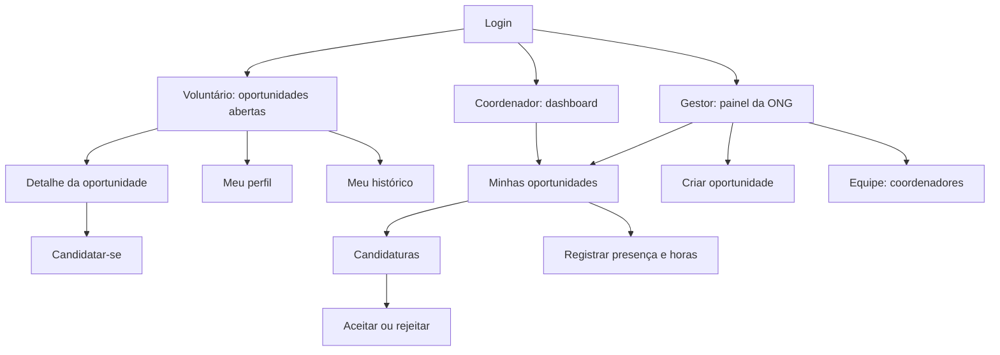

# Mockups e fluxo de telas

Mockups de baixa fidelidade feitos no Figma e exportados em PDF nesta pasta:

- [01 • Página inicial](01%20%E2%80%A2%20P%C3%A1gina%20inicial.pdf)
- [02 • Vagas e detalhes](02%20%E2%80%A2%20Vagas%20e%20detalhes.pdf)
- [03 • Perfil](03%20%E2%80%A2%20Perfil.pdf)
- [04 • Preferências](04%20%E2%80%A2%20Prefer%C3%AAncias.pdf)
- [05 • Minhas vagas](05%20%E2%80%A2%20Minhas%20vagas.pdf)
- [07 • Notificações](07%20%E2%80%A2%20Notifica%C3%A7%C3%B5es.pdf)
- [08 • Painel da ONG](08%20%E2%80%A2%20Painel%20da%20ONG.pdf)
- [09 • Anunciar vaga](09%20%E2%80%A2%20Anunciar%20vaga.pdf)

## Telas por perfil

| Perfil | Telas |
|---|---|
| Todos | Login, cadastro de voluntário |
| Voluntário | Oportunidades abertas (com filtro), detalhe da oportunidade, meu perfil, minhas candidaturas, meu histórico |
| Coordenador | Dashboard, oportunidades pelas quais responde, candidaturas da oportunidade, registro de presença e horas |
| Gestor (administrador da ONG) | Tudo o que o coordenador vê, para qualquer vaga da ONG, mais criar e editar oportunidades, definir o responsável de cada uma e cadastrar ou desativar coordenadores |

## Mapa de navegação

## Fluxo completo para demonstrar

1. Coordenador cria uma oportunidade com vagas limitadas.
2. Voluntário vê a oportunidade e se candidata.
3. Coordenador aceita a candidatura.
4. Depois da data, coordenador registra presença e horas.
5. Voluntário vê a participação no histórico.

## Identidade visual inicial (proposta)

- Nome: Voluntare
- Cor principal: verde (`#2E7D32`)
- Cor de apoio: azul escuro (`#1F4E79`)
- Fundo claro, textos escuros
- Tipografia: Inter (ou a fonte padrão do sistema)
- Botões e campos simples, sem imagens decorativas

## Fora do escopo

Chat, IA, certificados, gamificação, redes sociais, app mobile e doações não aparecem nos mockups.
